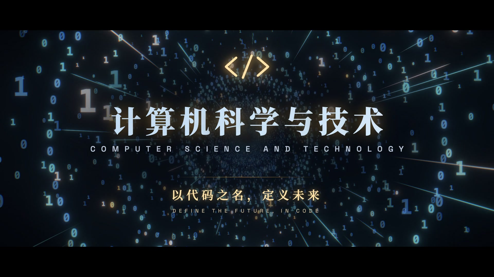
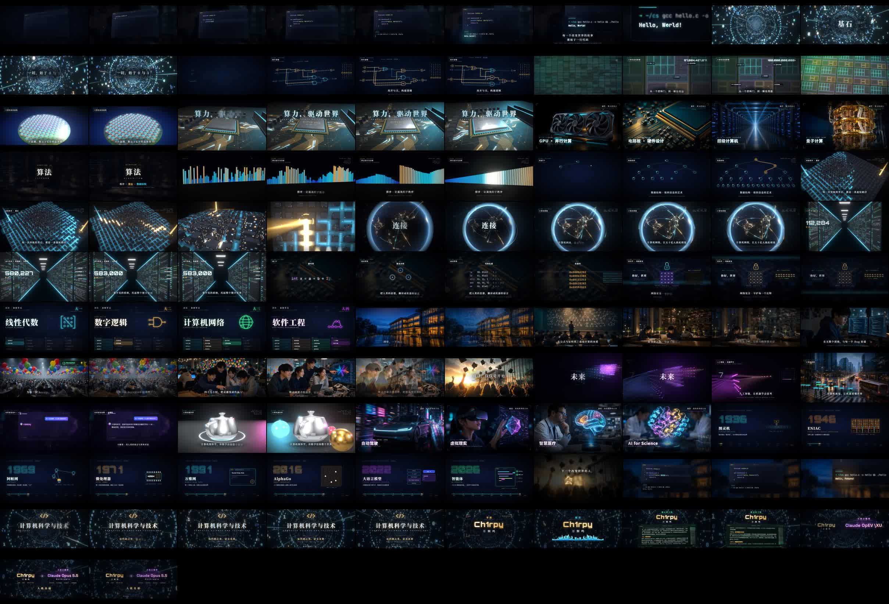

<div align="center">

# 计算机科学与技术 · 专业宣传片

**Computer Science — Program Promotional Film**

一支由代码驱动的专业宣传片。全部画面由 [Remotion](https://www.remotion.dev/) + [Three.js](https://threejs.org/) 程序化生成，配乐由 Python 逐样本合成。

[](https://www.remotion.dev/)
[](https://react.dev/)
[](https://threejs.org/)
[](./LICENSE)

</div>



> **一句话**：从编辑器里敲下的第一行 `printf("Hello, World!")` 出发，穿过二进制的隧道、硅片的版图、算法的光柱、城市与地球的灯火，最终回到同一个编辑器，把 `World` 改写成 `Future`。
>
> **从认识世界，到定义未来。**

---

## 目录

- [成片规格](#成片规格)
- [快速开始](#快速开始)
- [项目结构](#项目结构)
- [渲染管线](#渲染管线)
- [配乐管线](#配乐管线)
- [素材处理管线](#素材处理管线)
- [分镜与时间轴](#分镜与时间轴)
- [技术要点](#技术要点)
- [常用命令](#常用命令)
- [文档与素材授权](#文档与素材授权)
- [许可协议](#许可协议)

---

## 成片规格

| 项目 | 规格 |
| --- | --- |
| 片长 | **3 分 44 秒**（224.00 s / 13,440 帧） |
| 分辨率 | 1920 × 1080 |
| 帧率 | 60 fps（恒定帧率，逐帧确定性渲染） |
| 视频编码 | H.264，CRF 14，`yuv420p`，`angle` 软渲染 |
| 音频编码 | AAC，48 kHz 立体声，母带 **-13.5 LUFS** / 峰值 ≤ -1 dBFS |
| 遮幅 | 2.39:1 硬遮幅，随叙事节奏在 44s / 128.6s / 152s / 194.4s 处开合 |
| 场景数 | 23 个镜头组（S01–S23）+ 课程快闪 + 三组照片蒙太奇 |

**核心创意**：全片以一行代码开场，以同一行代码的改写收尾。开场在编辑器中逐字敲下 C 语言程序，编译运行后镜头穿过输出文字中字母 `o` 的内圈，坠入 0 与 1 构成的数字世界；结尾回到同一个编辑器，选中 `World` 改写为 `Future`，再次运行，再次穿过字母 `o`，抵达片名。

---

## 快速开始

### 环境要求

- **Node.js** ≥ 18（开发使用 v24.14.1）
- **Python** ≥ 3.10（开发使用 3.12.14）——仅在重新生成配乐或素材时需要
- **Chrome / Chromium** —— Remotion 渲染需要，可由 Remotion 自动下载
- **FluidSynth** —— 仅在重新合成配乐时需要（`brew install fluid synth`）

### 1. 安装依赖

```bash
npm install
```

### 2. 打开 Remotion Studio 预览

```bash
npm run studio
```

Studio 打开后即可逐帧查看、拖动时间轴、检查字幕与遮幅安全区。

### 3. 渲染成片

```bash
npm run render          # 输出 out/cs-mv.mp4
npm run render:h264     # 输出高质量母版 out/master.mp4
npm run render:share    # 输出分享版 out/share.mp4
```

> 完整渲染 13,440 帧需要一定时间（MacBook 上约 40–70 分钟，取决于是否开启硬件编码）。只想看某一帧请用 `npm run still`。

### 4. 抽帧自检

```bash
node tools/stills.mjs --scale=0.5 --prefix=chk 1.5 44 87.6 152 199.2
python tools/sheet.py chk 3 640        # 拼接成一张联络表便于整体审片
```

---

## 项目结构

```
cs-mv/
├── src/
│   ├── index.ts              # Remotion 入口（registerRoot）
│   ├── Root.tsx              # Composition 定义：MV / 1920×1080 / 60fps / 13440 帧
│   ├── MV.tsx                # ★ 时间线核心：SHOTS 镜头表 + HITS 爆点表 + 叠加层
│   ├── theme.ts              # 全局色板与字体栈
│   ├── fonts.ts              # 6 款本地字体的异步加载
│   │
│   ├── scenes/               # 23 个镜头场景
│   │   ├── S01Hello.tsx      #   序章：编辑器逐字打字 → 终端编译 → 穿越字母 o
│   │   ├── S02Binary.tsx     #   0/1 数字隧道
│   │   ├── S03Gates.tsx      #   全加器电路与真值表（数字逻辑）
│   │   ├── S04Chip.tsx       #   程序化芯片版图（CPU/GPU/L3/NPU/内存控制器）
│   │   ├── S06CPU.tsx        #   主板与 CPU —— 第一次爆点
│   │   ├── S07Quote.tsx      #   章节卡 + “程序 = 算法 + 数据结构”
│   │   ├── S08Sort.tsx       #   64 根光柱执行双调排序网络
│   │   ├── S09Tree.tsx       #   二叉搜索树生长与查找
│   │   ├── S10City.tsx       #   夜景城市 + Dijkstra 最短路径
│   │   ├── S11Globe.tsx      #   地球夜光与海底光缆（计算机网络）
│   │   ├── S12DataCenter.tsx #   数据中心通道
│   │   ├── S13Compiler.tsx   #   编译流水线 → RISC-V 机器码
│   │   ├── S14Crypto.tsx     #   AES-128 加密
│   │   ├── S15Photos.tsx     #   校园插曲：深度图驱动的 2.5D 视差
│   │   ├── S16Neural.tsx     #   神经网络信号流动
│   │   ├── S17AI.tsx         #   S17Vision 目标检测 / S17LLM 流式回答
│   │   ├── S18Graphics.tsx   #   犹他茶壶的扫描线渲染
│   │   ├── S19Timeline.tsx   #   计算简史里程碑
│   │   ├── S20Finale.tsx     #   S20You / S21Future / S22Title
│   │   ├── S23Credits.tsx    #   动态署名，职务随节拍翻转
│   │   ├── Courses.tsx       #   课程快闪：16 门课一拍一门
│   │   └── Montage.tsx       #   PhotoMontage：硬件 / 前沿两套照片快切
│   │
│   ├── components/           # 通用组件
│   │   ├── Text.tsx          #   Caption / BigTitle / CourseTag / RevealChars / ScrambleText
│   │   ├── Editor.tsx        #   代码编辑器与终端窗口
│   │   ├── Overlays.tsx      #   Grain / Vignette / Letterbox / Flashes
│   │   ├── Backdrop.tsx      #   照片背景层
│   │   └── Dust.tsx          #   浮尘粒子
│   │
│   ├── three/                # Three.js 场景基础设施
│   │   ├── common.tsx        #   CameraRig / Post 后期 / ComposerWarmup
│   │   └── dieShader.ts      #   骰子着色器
│   │
│   ├── lib/
│   │   ├── timing.ts         #   ★ 全局时间基准：FPS / BPM / 总时长
│   │   ├── anim.ts           #   缓动函数、噪声、随机数
│   │   └── beats.ts          #   从 beats.json 读取剪辑点
│   │
│   └── data/                 # 由 Python 管线生成的数据
│       ├── beats.json        #   剪辑点 / 爆点（配乐导出）
│       ├── cues.json         #   镜头内的动画触发点
│       ├── spectrum.json     #   频谱数据（片尾可视化）
│       ├── detections.json   #   DETR 目标检测框（街景镜头）
│       ├── typing.json       #   逐字符打字时序（保留人类停顿）
│       └── prompt.json       #   创作提示词（片尾引用）
│
├── public/                   # 静态素材（138 MB）
│   ├── audio/music.wav       #   母带配乐 226 s / 48 kHz
│   ├── fonts/                #   Noto Serif SC / Noto Sans SC / JetBrains Mono
│   │                         #   / Space Grotesk / Orbitron / Inter
│   ├── photos/               #   32 张照片 + 同名 *_depth.png 深度图
│   └── textures/             #   地球贴图、夜空、6 张胶片颗粒
│
├── audio/                    # 配乐工程（Python）
│   ├── compose2.py           #   ★ 当前版本：旋律电子配乐，112 小节
│   ├── compose.py            #   v1 配乐（历史版本）
│   ├── gufeng.py             #   古风器乐《墨染江南》
│   ├── analyze.py            #   响度/频谱分析，输出频谱图与包络图
│   └── sf2list.py            #   列出 .sf2 音色库预设
│
├── tools/                    # 素材处理工具
│   ├── depth.py              #   Depth Anything V2 生成深度图
│   ├── detect.py             #   DETR-ResNet-101 生成目标检测框
│   ├── stills.mjs            #   批量抽帧
│   ├── sheet.py              #   拼接抽帧联络表
│   ├── prep_new.sh           #   一键超分 + 深度图批处理
│   └── prompt.md             #   ★ 创作提示词 v3.2（完整创作规格）
│
├── remotion.config.ts        # 渲染配置（CRF / 编码器 / 并发）
├── docs/                     # README 配图
└── LICENSE / CREDITS.md
```

---

## 渲染管线

### 时间线模型

所有时间在代码里统一以**秒**书写，在 `src/lib/timing.ts` 中集中定义基准：

```ts
export const FPS = 60;
export const BPM = 120;
export const BEAT = 60 / BPM;   // 0.5 s
export const BAR  = BEAT * 4;   // 2.0 s —— 恰好一帧剪辑 = 一拍
```

配乐 120 BPM、每小节 2 秒，**所有剪辑点都落在拍点上**。`src/MV.tsx` 的 `SHOTS` 表用「起止秒 + 场景自身时间原点」描述每一个镜头：

```ts
type Shot = {
  id: string;
  at: number;      // 在成片时间轴上的起点
  from: number;    // 场景内部时间轴的起点
  to: number;      // 场景内部时间轴的终点
  origin?: number; // 场景实际被渲染的绝对时刻（默认 = from）
  el: (offset: number) => React.ReactNode;
};
```

`origin` 的存在是为了让「同一个场景在片中被复用/错位复用」成为可能 —— 例如 `S10City` 在成片中从 78s 开始，但其内部时间原点是 70s。

### 确定性渲染

所有动画都是**时间的纯函数**：

- 没有 `Math.random()`，随机性一律走 `mulberry32(seed)` 确定性伪随机（`src/lib/anim.ts`）
- 没有 `Date.now()` 参与画面计算
- 没有依赖真实时间的缓动或过渡

因此任意一帧都能被独立、重复、逐位复现地渲染出来，这是 Remotion 能做分布式渲染的前提。

### 后期处理

`src/three/common.tsx` 中的 `Post` 组件统一挂载：

- **Bloom** —— HDR 发光元素配 Bloom，拒绝廉价的纯色描边
- **Chromatic Aberration** —— 径向色差，爆点处增强
- **ComposerWarmup** —— EffectComposer 的通道在首次 `advance()` 后才接线，首帧会黑；该组件在布局阶段多推进两帧再放行 `delayRender`，避免出现意外黑帧

叠加层（`src/components/Overlays.tsx`）：

| 组件 | 作用 |
| --- | --- |
| `Grain` | 6 张颗粒贴图循环，`overlay` 混合，每 2 帧换一次偏移 |
| `Vignette` | 径向暗角 |
| `Letterbox` | 2.39:1 遮幅，高度按时间轴分段升降 |
| `Flashes` | 爆点白闪，按 `HITS` 表触发，强度随时间平方衰减 |

### 2.5D 照片视差

`src/scenes/S15Photos.tsx` 的 `Photo` 组件用一张自定义 GLSL 着色器做深度驱动的伪 3D：

```glsl
for (int i = 0; i < 6; i++) {
  float d = texture2D(uDepth, p).r;
  float k = d - uFocus;                                   // 与焦平面的深度差
  vec2 q = uCenter + (uv - uCenter) / (uZoom * (1.0 + uDolly * k));
  p = q - uShift * k;                                     // 近景位移更多
}
```

6 次迭代近似出透视关系，近景人物比远景背景移动更多，从而在平面照片上产生纵深。

---

## 配乐管线

配乐**完全由 Python 合成**，不是采样现成音乐。核心脚本是 `audio/compose2.py`：

- **和声** —— A 小调，112 小节（224 秒），每小节恰好 2 秒，所有视觉剪辑点落在拍点上
- **音色** —— 三角钢琴（Salamander Grand Piano）与弦乐（MuseScore General）经 **FluidSynth** 渲染 `.sf2`；合成器、鼓组与音效由 numpy 直接合成（BLEP 振荡器 + SVF 滤波 + 卷积混响 + 前瞻限幅器）
- **主旋律** —— 一条「3-3-2」切分节奏贯穿全片；前奏与插曲由钢琴半速奏出，三次高潮由合成器全速唱响
- **母带** —— `pedalboard` 混音 → `pyloudnorm` 归一到 **-13.5 LUFS** → 峰值限制在 -1 dBFS → 导出 `public/audio/music.wav`
- **回灌视觉** —— 配乐脚本同时导出 `src/data/beats.json`，剪辑点与爆点由配乐反向驱动画面

```bash
# 需要先安装 FluidSynth 与 requirements.txt
.venv/bin/python audio/compose2.py

# 响度与频谱体检
.venv/bin/python audio/analyze.py public/audio/music.wav
```

> `audio/gufeng.py` 是另一首独立作品《墨染江南》（72 BPM，74 小节，D 宫五声），不参与本片渲染。

---

## 素材处理管线

照片经过 **超分 → 深度估计 → 视差渲染** 三步：

```bash
# 1. 超分（Real-ESRGAN，4×）—— 需要本地 realesrgan-ncnn-vulkan
tools/prep_new.sh

# 2. 深度图（Depth Anything V2 Large，自动使用 MPS / CPU）
.venv/bin/python tools/depth.py

# 3. 街景目标检测（DETR-ResNet-101）
.venv/bin/python tools/detect.py
```

`tools/depth.py` 会把每张照片缩放到 2560×1440 存为 JPEG，同时生成 1280×720 的 `*_depth.png` 深度图（归一化到 0–1 并做高斯模糊）。检测框写入 `src/data/detections.json`，供街景镜头绘制实时检测框。

---

## 分镜与时间轴



> 全片 80 帧抽样联络表（`tools/sheet.py` 生成）。点击图片可查看原图。

| 时间 | 章节 | 内容 |
| --- | --- | --- |
| 00:00–00:16 | **序章** | 编辑器逐字敲出 C 程序 → 终端编译运行 → 输出 `Hello, World!` → 钻进字母 `o` |
| 00:16–01:00 | **第一章 · 基石** | 二进制隧道 → 全加器电路与真值表 → 芯片版图标注 → 晶圆 → **00:44 第一次爆点**「算力，驱动世界」→ 硬件十连切 |
| 01:00–01:28 | **第二章 · 算法** | 章节卡「程序 = 算法 + 数据结构」→ 64 柱双调排序网络 → 二叉搜索树 → 夜景城市 Dijkstra 最短路径 → 垂直拉升 |
| 01:28–02:00 | **第三章 · 连接** | 地球夜光与海底光缆 → 数据中心通道（双十一每秒 58.3 万笔）→ 编译流水线到 RISC-V 机器码 → AES 加密 |
| 02:00–02:08 | **课程快闪** | 「四年，你将学习」——16 门核心课程一拍一门，底部课程表逐格点亮 |
| 02:08–02:32 | **插曲 · 青春** | 8 张校园写实照片，深度图驱动 2.5D 视差，暖色漏光交叉溶解，末尾「而这，仅仅是开始」 |
| 02:32–02:56 | **第四章 · 未来** | 神经网络信号流动 → 真实目标检测 → 大模型逐字流式回答 → 犹他茶壶扫描线渲染 → 前沿十二连切 |
| 02:56–03:12 | **计算简史** | 1936 图灵机 / 1946 ENIAC / 1969 ARPANET / 1971 Intel 4004 / 1991 万维网 / 2016 AlphaGo / 2022 大语言模型 / 2026 智能体 |
| 03:12–03:30 | **尾声** | 「下一个改变世界的人，会是你」→ 回到编辑器写下 `Hello, Future!` → 再次穿过字母 `o` → 片名「计算机科学与技术 / 以代码之名，定义未来」 |
| 03:30–03:44 | **片尾** | 动态署名，职务随节拍翻转，以「人机共创」收束 |

### 叙事严谨性

片中出现的每一个技术细节都力求可查证：RISC-V 机器码按真实指令格式编码；AES 使用 FIPS-197 标准测试密钥，「你好，世界」的 UTF-8 编码恰好构成一个分组；ENIAC 17,468 根电子管；Intel 4004 集成 2,300 颗晶体管、主频 740 kHz；ARPANET 1969-10-29 首次消息 `LO`；AlphaGo 第二局第 37 手；双十一订单创建峰值每秒 58.3 万笔（2020 年）。无法核实的一律留白。

完整创作规格见 [`tools/prompt.md`](./tools/prompt.md)。

---

## 技术要点

- **逐帧确定性** —— 伪随机数、噪声与缓动全部由时间纯函数驱动，同一帧永远渲染出同一结果
- **程序化建模** —— 芯片版图、晶圆、城市、数据中心、地球全部由着色器生成，放大到任意倍数依然清晰
- **共享时间基准** —— 画面、配乐、剪辑点共用一套秒/拍/小节换算（`src/lib/timing.ts`），杜绝音画漂移
- **本地字体** —— 6 款字体随仓库分发，渲染时经 `@remotion/fonts` 注入，跨机器结果一致，不依赖系统字体
- **双层后期** —— Three.js 侧的 Bloom / 色差 + DOM 侧的颗粒 / 暗角 / 遮幅 / 白闪
- **安全区意识** —— 字幕、课程标签与信息栏统一避开遮幅区域

---

## 常用命令

| 命令 | 说明 |
| --- | --- |
| `npm run studio` | 打开 Remotion Studio 预览 |
| `npm run render` | 渲染 `out/cs-mv.mp4` |
| `npm run render:h264` | 渲染高质量母版 `out/master.mp4` |
| `npm run render:share` | 渲染分享版 `out/share.mp4` |
| `npm run still` | 渲染当前帧静帧 |
| `npm run typecheck` | TypeScript 类型检查 |
| `npm run stills -- 1.5 44` | 批量抽帧到 `out/stills/` |
| `npm run sheet -- chk` | 拼接抽帧联络表 |

---

## 发布到 GitHub

仓库已经可以推送，但推送前请先替换以下占位内容：

| 位置 | 需要修改 |
| --- | --- |
| `package.json` | `repository` / `homepage` / `bugs` 中的 `<your-username>` |
| `README.md` | 顶部的徽章链接（可选）、封面图与联系方式 |
| `LICENSE` | 协议本身无需修改；版权人信息可按需补充 |
| `CREDITS.md` | 若替换了照片或字体，同步更新来源说明 |

推送步骤：

```bash
git init -b main
git add -A
git commit -m "feat: 计算机科学与技术专业宣传片 v1.0"
git remote add origin https://github.com/<your-username>/cs-mv.git
git push -u origin main
```

### 仓库体积

`public/` 约 **138 MB**，其中 `audio/music.wav` 62 MB、字体 42 MB、照片与深度图 28 MB、贴图 7 MB。
本仓库**未使用 Git LFS**，全部以普通 Git 对象提交 —— 任何人 `git clone` 即可直接使用，无需额外工具。
若后续素材继续增长，可改用 [Git LFS](https://git-lfs.com/)（GitHub 免费额度为 10 GiB 存储 + 10 GiB 流量/月）。

### 建议的 GitHub 配置

- **Description**：`计算机科学与技术专业宣传片 · Remotion + Three.js 程序化生成 · 1080p60`
- **Topics**：`remotion` `threejs` `react` `promotional-video` `computer-science` `程序化生成`
- **About → Website**：留空或指向成片发布页

---

## 文档与素材授权

| 文件 | 内容 |
| --- | --- |
| [`tools/prompt.md`](./tools/prompt.md) | 创作提示词 v3.2 —— 完整创作规格（角色、结构、镜头语言、视觉风格、转场、文案、音乐、禁忌、质检清单） |
| [`CREDITS.md`](./CREDITS.md) | 全部第三方素材的来源与许可 |
| [`src/data/prompt.json`](./src/data/prompt.json) | 提示词的 JSON 版本（片尾署名场景直接引用） |

---

## 许可协议

本仓库采用 **[CC BY-NC-SA 4.0](./LICENSE)**（署名-非商业性使用-相同方式共享 4.0）。

- **代码与文档**：可自由使用、修改与再发布，**需署名**，**不可用于商业目的**，衍生作品须以相同协议发布
- **第三方素材**（字体、照片、贴图、音色库、依赖库）各自遵循其原始许可，详见 [`CREDITS.md`](./CREDITS.md)

> ⚠️ **Remotion 许可提示**：Remotion 采用自定义许可协议，个人与 3 人以下团队免费商用，超过 3 人的公司需购买 Company License。发布本仓库前请确认你的使用场景符合 [Remotion License](https://github.com/remotion-dev/remotion/blob/main/LICENSE.md) 的要求。

---

## 免责声明

本项目为计算机科学与技术专业的**教学演示作品**，由 AI 与人类协作完成（片尾署名「人机共创」）。片中涉及的院系名称、课程设置与统计数字仅用于叙事演示，不代表任何具体院校的官方口径。

---

<div align="center">

**以代码之名，定义未来。**

*Built with Remotion · Three.js · React · Python*

</div>
